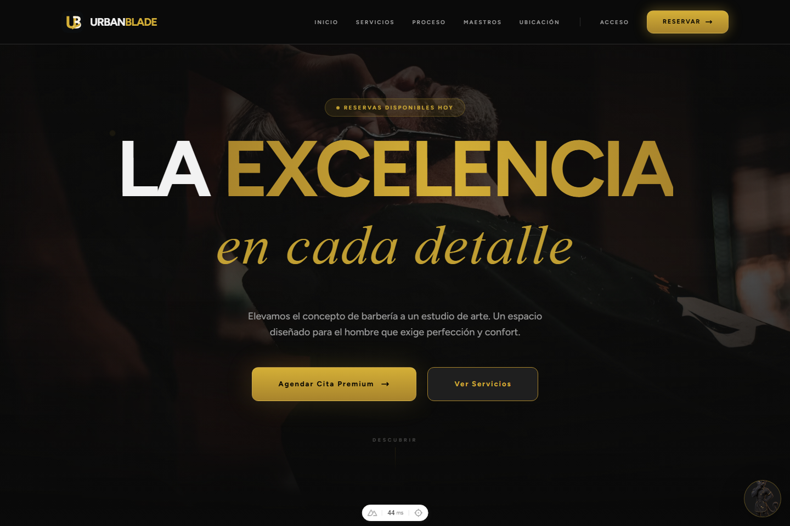

# UrbanBlade · Frontend

Aplicación web para gestionar una barbería: reservas, agenda, cobros, inventario,
tienda y reportes, con experiencias para administración, recepción, barberos y clientes.

[](https://github.com/KikeGonRam/frontend_Urbanblade/actions/workflows/ci.yml)
[](https://github.com/KikeGonRam/frontend_Urbanblade/actions/workflows/cypress.yml)

[Sitio web](https://urbanblade.com.mx/) · [Backend](https://github.com/KikeGonRam/barber) ·
[Documentación](docs/README.md) · [Arquitectura](docs/ARQUITECTURA.md) · [Contribuir](CONTRIBUTING.md) · [Seguridad](SECURITY.md)



## Funcionalidades

- Reservas con consulta de disponibilidad por barbero, servicio y fecha.
- Agenda y paneles por rol; el ingeniero tiene acceso de solo lectura.
- Cobros con efectivo, transferencia y tarjeta mediante Stripe.
- Inventario, pedidos, recibos, lealtad y membresía digital.
- Reportes, gráficas, analítica, reseñas y muro social.
- Sitio público con SSR, PWA y cuatro temas visuales.

Las capturas son ilustrativas; los permisos y estados los valida también la API.

## Stack y arquitectura

Nuxt 4, Vue 3, TypeScript y Tailwind CSS 4. Chart.js y FullCalendar cubren
gráficas y agenda; Vitest, Playwright y Cypress cubren distintos niveles de pruebas.

Consume la API de [`barber`](https://github.com/KikeGonRam/barber) mediante
tokens Bearer propios (`mobile_api_tokens`).
El contrato está en [contract/openapi.yaml](contract/openapi.yaml);
los tipos generados, en [app/types/api.d.ts](app/types/api.d.ts).

## Desarrollo local

Requisitos: Node.js 24, npm y el backend local para datos y autenticación reales.

```powershell
git clone https://github.com/KikeGonRam/frontend_Urbanblade.git frontend-urban
cd frontend-urban
npm ci --legacy-peer-deps
Copy-Item .env.example .env
npm run dev
```

Abre [localhost:3000](http://localhost:3000). La API predeterminada es
`http://127.0.0.1:8000/api/v1`.
Revisa [.env.example](.env.example): `NUXT_PUBLIC_API_BASE` y la clave
**publicable** `NUXT_PUBLIC_STRIPE_KEY`. Todo valor `NUXT_PUBLIC_*` es visible
al cliente; las claves secretas pertenecen al backend.

El flag `--legacy-peer-deps` coincide con CI. Conserva el lockfile y evita
actualizar dependencias como parte de una corrección documental.
Las cuentas se explican en
[la guía de acceso del backend](https://github.com/KikeGonRam/barber/blob/main/docs/ACCESOS.md).

## Validación

| Comando | Qué comprueba |
| --- | --- |
| `npx eslint . --max-warnings=0` | Estilo con la misma exigencia de CI. |
| `npm run test:unit` | Utilidades y componentes con Vitest. |
| `npm run contract:check` | Tipos generados frente al contrato local. |
| `npm run build` | Compilación; no despliega. |
| `npm run test:e2e -- --workers=1` | Playwright, con build y servidores de API simulada propios. |
| `npm run audit:gate` | Auditoría con excepciones que caducan. |
| `python scripts/check_docs.py --all` | Enlaces locales de toda la documentación mantenida. |

Playwright usa los puertos 3100 y 8099 y no reutiliza servidores.
Las pruebas con API simulada verifican el frontend; no certifican la integración
con una cuenta real ni el funcionamiento de producción.

Cypress necesita el build y los servidores activos. Consulta el procedimiento
completo en [docs/CYPRESS_CLOUD.md](docs/CYPRESS_CLOUD.md).
`npm run cypress:run` por sí solo no los levanta.

Si cambia la API, revisa `npm run contract:sync` y su diff.
No regeneres el contrato para un cambio de documentación.

## CI y publicación

[CI](.github/workflows/ci.yml) ejecuta lint, build, auditoría, Vitest, contrato,
Playwright y construcción/arranque de Docker.
[Cypress](.github/workflows/cypress.yml) corre en su workflow propio.
[Documentación](.github/workflows/documentation.yml) valida los enlaces de la documentación mantenida.

Estos workflows corren con PR y push a `main` y no contienen publicación ni
despliegue. Los servicios externos conectados a GitHub requieren su propia
revisión antes de fusionar. Consulta [CI/CD](docs/CI_CD.md).

## Documentación y colaboración

El [índice documental](docs/README.md) reúne las guías de interfaz, pruebas y
arquitectura. La arquitectura, pruebas y decisiones tienen guías canónicas; los planes cerrados se conservan en Git.
Consulta [CONTRIBUTING.md](CONTRIBUTING.md) para preparar un cambio y
[SECURITY.md](SECURITY.md) para comunicar vulnerabilidades sin exponer datos.

No se declara una licencia nueva en esta actualización. Revisa los términos del
repositorio y sus dependencias antes de redistribuirlo.
