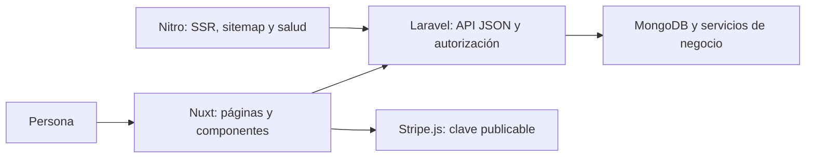

# Arquitectura del frontend

Revisión contra el código: 28 de octubre de 2026. Describe el checkout, no certifica
la configuración o el comportamiento actual de producción.

## Contexto

UrbanBlade es una aplicación Nuxt 4/Vue 3/TypeScript separada de Laravel.
La lógica de negocio, persistencia, permisos efectivos, precios y pagos se resuelven
en [barber](https://github.com/KikeGonRam/barber). Nuxt presenta las experiencias
públicas y los paneles por rol; no se conecta directamente a MongoDB.

## Estructura y responsabilidades

| Carpeta / fuente | Responsabilidad |
| --- | --- |
| [app/pages](../app/pages) | Rutas públicas y operativas; composición de pantallas. |
| [app/layouts](../app/layouts) | Estructura compartida y navegación. |
| [app/components](../app/components) | Formularios, dashboards, gráficas y componentes reutilizables. |
| [app/composables](../app/composables) | Sesión, API, navegación, carrito, tema, consentimiento y notificaciones. |
| [app/middleware](../app/middleware) | Acceso y redirecciones de interfaz por sesión/rol. |
| [app/types](../app/types) | Tipos generados del contrato y adaptaciones. |
| [server](../server) | SSR/Nitro, salud, sitemap y filtros HTTP. No es un proxy general de la API de negocio. |
| [public](../public) | Recursos públicos, manifiesto, service worker y página offline. |
| [contract](../contract) | Copia versionada del OpenAPI del backend. |
| [tests](../tests), [e2e](../e2e), [cypress](../cypress) | Pruebas con distintos niveles y dependencias. |

El estado compartido se maneja mediante composables y las primitivas de Nuxt
(`useState`, `useCookie`); no se debe documentar Pinia como almacén implementado.

## Renderizado y SEO

[nuxt.config.ts](../nuxt.config.ts) define las reglas efectivas:
SSR por defecto; numerosos prefijos autenticados usan `ssr: false`.
Una página pública no es necesariamente completamente renderizada en servidor:
en la landing, servicios y barberos se cargan con `server: false`, mientras
los datos de barbería usados en SEO/JSON-LD se solicitan mediante SSR.

[app/pages/index.vue](../app/pages/index.vue) construye los metadatos y el
JSON-LD HairSalon con la información disponible. No inventar dirección,
coordenadas, horario o calificaciones. El sitemap está en
[server/routes/sitemap.xml.ts](../server/routes/sitemap.xml.ts).
Para comprobar SEO hay que inspeccionar HTML inicial, no solo el DOM tras hidratar.

## Sesión, roles y llamadas HTTP

[useAuth](../app/composables/useAuth.ts) usa tokens Bearer propios del backend.
El login indica `plataforma: web`. La cookie `ub_token`:
es legible por JavaScript, SameSite=Lax y Secure en producción; su duración
configurada es 180 días. La vigencia efectiva del token la decide Laravel
(actualmente ventana web de inactividad de 30 días por defecto).
La presencia de cookie no prueba que el token siga siendo válido.

[useApi](../app/composables/useApi.ts) añade Authorization, centraliza llamadas,
descargas autenticadas y manejo de 401/mantenimiento. Los tipos genéricos
facilitan compilación: no validan automáticamente el JSON recibido en ejecución.
Los middleware de Nuxt mejoran navegación; Laravel debe comprobar permisos y
propiedad del recurso en cada operación.

El callback [auth/callback](../app/pages/auth/callback.vue) recibe el token en
query string, lo guarda y limpia la URL mediante history.replaceState.
Ese borrado no evita que la URL original pase por infraestructura o logs.
La evolución a un intercambio de código o BFF requiere una decisión técnica propia.

## Contrato de API

[scripts/contract.mjs](../scripts/contract.mjs) mantiene
[contract/openapi.yaml](../contract/openapi.yaml) y
[app/types/api.d.ts](../app/types/api.d.ts).
[app/types/contract.ts](../app/types/contract.ts) adapta nulabilidad y alias.

- `contract:check` verifica que tipos y copia local coincidan.
- `contract:drift` compara con barber@main; en CI su fallo es informativo.
- `contract:sync` toma primero el archivo del backend hermano local, si existe,
  y si no lo descarga de main; revisar la procedencia y el diff antes de aceptar.
- Los ejemplos y mocks usan datos ficticios; no equivalen a integración real.

## Interfaz y módulos

Reservas y agenda, cobros, pedidos/carrito, inventario, perfiles, membresías,
notificaciones, muro, reportes y observabilidad tienen pantallas propias.
Chart.js y FullCalendar cubren gráficas y agenda; Stripe.js confirma pagos
con clave publicable. Las claves secretas y la validación final quedan en backend.

Los temas `noir`, `acero`, `salon` y `libreta` comparten navegación y permisos.
Consultar [interfaz](INTERFAZ.md) y
[observabilidad de ingeniero](ADR-002-OBSERVABILIDAD-INGENIERO.md).

## PWA y privacidad

[public/sw.js](../public/sw.js) maneja Push y cachés limitadas:
navegación con red primero, assets con caché primero y actualización de imágenes
en segundo plano. Omite métodos distintos de GET, otros orígenes, /api/ y
peticiones con Range. No soporta reservas o cobros offline.

La caché de navegación no aplica una exclusión específica a rutas autenticadas o
URLs sensibles; revisar ese alcance antes de asumir que ninguna página de sesión
puede persistir. El objetivo es no almacenar tokens ni datos privados.
El modo offline no acredita una sesión válida.

[useConsent](../app/composables/useConsent.ts) carga GTM tras aceptar analítica;
al retirar consentimiento intenta borrar cookies de analítica y recarga.
La cookie de tema y la de sesión cumplen funciones distintas de la analítica.

## Servidor y operación

[server/middleware](../server/middleware) limita métodos y rutas sospechosas.
El filtro de abuso depende de TRUSTED_PROXY_HOPS y mantiene estado en memoria:
no equivale a un rate limiter distribuido ni debe activarse con una cadena de
proxies inventada. [security-headers](../server/plugins/security-headers.ts)
configura CSP con nonce y HSTS en producción; el entorno remoto debe verificarse.

[Dockerfile](../Dockerfile) construye y ejecuta Nitro con Node 22, usuario node
y salud en /api/health. CI usa Node 24 y npm ci --legacy-peer-deps, mientras
el Dockerfile usa npm install. Es una diferencia documentada, no corregida aquí.
Las integraciones de publicación externas deben revisarse antes de un push.

## Decisiones, pruebas y límites

[Decisiones](DECISIONES.md), [pruebas](PRUEBAS.md), [CI/CD](CI_CD.md) y
[seguridad documental](SEGURIDAD_DOCUMENTACION.md) contienen el detalle.
No inferir certificación de seguridad, accesibilidad o producción por un build
o por mocks aprobados.
